<!-- Generated by scripts/generate-advisor-preset-audit.cjs. Edit packages/advisor/catalog.js, then regenerate. -->
# Lumino 首页顾问：预制问答路径与默认答案审计

- 内容版本：`2026-11-05.1`
- 一级预制问题：9 个
- 二级选择与确定性答案：37 条
- 工具直达路径：1 条（CN Code）
- 执行原则：点击预制问题或二级选择时只读取本地目录，不调用模型；只有用户自由输入且未命中固定意图时，才进入检索或模型路径。

## 完整路径图

```mermaid
flowchart LR
  START([进入官网，顾问自动展开]) --> TOPICS{选择预制问题}
  TOPICS --> T_cbam_scope["我的产品是否可能涉及 CBAM？"]
  E_cbam_scope(["专属固定答案 + 资料 + CTA"])
  T_cbam_scope --> R_cbam_scope_steel["钢铁"] --> E_cbam_scope
  T_cbam_scope --> R_cbam_scope_aluminium["铝"] --> E_cbam_scope
  T_cbam_scope --> R_cbam_scope_other_cbam["水泥、化肥、氢或其他"] --> E_cbam_scope
  T_cbam_scope --> R_cbam_scope_unknown["我不确定"] --> E_cbam_scope
  TOPICS --> T_cbam_data_start["进口商让我准备碳数据，从哪里开始？"]
  E_cbam_data_start(["专属固定答案 + 资料 + CTA"])
  T_cbam_data_start --> R_cbam_data_start_template["有模板"] --> E_cbam_data_start
  T_cbam_data_start --> R_cbam_data_start_deadline["只有时限"] --> E_cbam_data_start
  T_cbam_data_start --> R_cbam_data_start_request_only["只是口头要求"] --> E_cbam_data_start
  T_cbam_data_start --> R_cbam_data_start_unknown["不确定"] --> E_cbam_data_start
  TOPICS --> T_cbam_vs_pcf["CBAM 和产品碳足迹有什么区别？"]
  E_cbam_vs_pcf(["专属固定答案 + 资料 + CTA"])
  T_cbam_vs_pcf --> R_cbam_vs_pcf_eu_importer["欧盟进口商"] --> E_cbam_vs_pcf
  T_cbam_vs_pcf --> R_cbam_vs_pcf_brand["品牌或客户采购"] --> E_cbam_vs_pcf
  T_cbam_vs_pcf --> R_cbam_vs_pcf_both["两者都要"] --> E_cbam_vs_pcf
  T_cbam_vs_pcf --> R_cbam_vs_pcf_internal["企业内部管理"] --> E_cbam_vs_pcf
  TOPICS --> T_esg_ghg["客户要求 ESG、碳盘查或 Scope 1/2/3"]
  E_esg_ghg(["专属固定答案 + 资料 + CTA"])
  T_esg_ghg --> R_esg_ghg_report["ESG 报告"] --> E_esg_ghg
  T_esg_ghg --> R_esg_ghg_questionnaire["客户或评级问卷"] --> E_esg_ghg
  T_esg_ghg --> R_esg_ghg_inventory["组织碳盘查"] --> E_esg_ghg
  T_esg_ghg --> R_esg_ghg_scope_data["Scope 1/2/3 数据"] --> E_esg_ghg
  TOPICS --> T_pcf_data_start["产品碳足迹要从哪里采数据？"]
  E_pcf_data_start(["专属固定答案 + 资料 + CTA"])
  T_pcf_data_start --> R_pcf_data_start_boundary["系统边界还没定"] --> E_pcf_data_start
  T_pcf_data_start --> R_pcf_data_start_collect["不知道采哪些数"] --> E_pcf_data_start
  T_pcf_data_start --> R_pcf_data_start_hotspot["算完了但不会讲热点"] --> E_pcf_data_start
  T_pcf_data_start --> R_pcf_data_start_unknown["不确定"] --> E_pcf_data_start
  TOPICS --> T_inventory_first_year["组织碳盘查第一年怎么起步？"]
  E_inventory_first_year(["专属固定答案 + 资料 + CTA"])
  T_inventory_first_year --> R_inventory_first_year_bills["有电费/燃料账单"] --> E_inventory_first_year
  T_inventory_first_year --> R_inventory_first_year_sites["有多厂清单"] --> E_inventory_first_year
  T_inventory_first_year --> R_inventory_first_year_scope3["客户点名要 Scope 3"] --> E_inventory_first_year
  T_inventory_first_year --> R_inventory_first_year_unknown["还很少"] --> E_inventory_first_year
  TOPICS --> T_eudr_csddd["EUDR 或 CSDDD，出口工厂先备什么？"]
  E_eudr_csddd(["专属固定答案 + 资料 + CTA"])
  T_eudr_csddd --> R_eudr_csddd_eudr["商品追溯 / EUDR"] --> E_eudr_csddd
  T_eudr_csddd --> R_eudr_csddd_csddd["尽职管理 / CSDDD"] --> E_eudr_csddd
  T_eudr_csddd --> R_eudr_csddd_both["两者都提到"] --> E_eudr_csddd
  T_eudr_csddd --> R_eudr_csddd_unknown["说不清"] --> E_eudr_csddd
  TOPICS --> T_renewable_power["想规划绿电、绿证或可再生能源证明"]
  E_renewable_power(["专属固定答案 + 资料 + CTA"])
  T_renewable_power --> R_renewable_power_specified["已指定"] --> E_renewable_power
  T_renewable_power --> R_renewable_power_target_only["只有比例目标"] --> E_renewable_power
  T_renewable_power --> R_renewable_power_planning["内部规划中"] --> E_renewable_power
  T_renewable_power --> R_renewable_power_unknown["还不确定"] --> E_renewable_power
  TOPICS --> T_service_triage["不确定需要哪项服务"]
  E_service_triage(["专属固定答案 + 资料 + CTA"])
  T_service_triage --> R_service_triage_eu_importer["欧盟进口商"] --> E_service_triage
  T_service_triage --> R_service_triage_customer["客户或品牌"] --> E_service_triage
  T_service_triage --> R_service_triage_regulator["监管或市场准入"] --> E_service_triage
  T_service_triage --> R_service_triage_internal["公司内部"] --> E_service_triage
  T_service_triage --> R_service_triage_unknown["不确定"] --> E_service_triage
  FREE[用户自由输入] --> CN{命中 CN / HS / TARIC 意图?}
  CN -->|是| TOOL[CN Code 工具说明 + 试算器 + 编码指南 + 人工复核]
  CN -->|否| RETRIEVAL[受控检索 / 模型回答或安全兜底]
```

## 逐项答案核对

### 我的产品是否可能涉及 CBAM？

- 路径 ID：`cbam_scope`
- 一级默认答案：是否涉及 CBAM 不能只看产品名称，需要核对欧盟进口端使用的 CN Code、产品类别和当期覆盖范围。我可以先帮你确定应查哪些信息，但不会直接作出正式编码认定。
- 追问：你的主要出口产品属于哪一类？
- 资料：`cbam-hs-cn-codes`
- CTA：查看编码核对方法（`/knowledge/article?id=cbam-hs-cn-codes`）

| 用户选择 | Reply ID | 对应默认答案 |
|---|---|---|
| 钢铁 | `steel` | 钢铁产品是 CBAM 的重点范围之一，但仍要按欧盟进口端使用的 8 位 CN Code 核对具体货物。先向进口商确认申报编码，再用编码指南检查对应品类和工艺范围。 |
| 铝 | `aluminium` | 铝产品可能属于 CBAM，但不能只凭材质名称判断。请先取得进口商使用的 8 位 CN Code，并确认产品形态与生产工艺，再核对当期覆盖范围。 |
| 水泥、化肥、氢或其他 | `other-cbam` | 水泥、化肥、氢等品类中只有特定 CN Code 被覆盖，并非同类产品全部自动纳入。先整理产品说明、现有 HS Code 和欧盟进口编码，再逐项核对。 |
| 我不确定 | `unknown` | 先准备产品中英文名称、用途、材质或成分、生产工艺，以及出口报关使用的 HS Code，并向欧盟进口商索取其申报的 CN Code。信息齐全后才能进行初步范围判断。 |

### 进口商让我准备碳数据，从哪里开始？

- 路径 ID：`cbam_data_start`
- 一级默认答案：先不要直接填数。先固定四件事：进口商要求的期间与模板、产品与 CN Code、生产厂区与产线、是否有需要纳入的前体材料。再按这个范围收集产量、燃料、外购电热和供应商声明。
- 追问：进口商是否已给你模板或提交时限？
- 资料：`cbam-importer-data`、`cbam-precursors`、`cbam-default-vs-actual`
- CTA：查看资料准备清单（`/knowledge/article?id=cbam-importer-data`）

| 用户选择 | Reply ID | 对应默认答案 |
|---|---|---|
| 有模板 | `template` | 先锁定模板版本、报告期间、提交口径和截止时间，再把每个字段映射到产品、产量、燃料、电热、工艺排放和前体材料的数据来源。无法填写的字段单独列为缺口，不要用估算值直接覆盖。 |
| 只有时限 | `deadline` | 只有时限时，应立即向进口商确认使用的模板、产品 CN Code、报告期间、生产设施以及是否需要前体材料数据。同时先建立最小资料包：产量、燃料、电热、工艺和供应商声明。 |
| 只是口头要求 | `request-only` | 先把口头要求转成书面需求，至少确认产品和 CN Code、数据期间、用途、模板、截止时间及接收方。未确认这些边界前，可以盘点数据来源，但不宜直接出正式数据表。 |
| 不确定 | `unknown` | 先向进口商发送五个确认项：要哪些产品、使用什么 CN Code、覆盖哪个期间、采用哪份模板、何时提交。内部同时确认生产厂区和前体材料，这样可以快速形成可执行的数据清单。 |

### CBAM 和产品碳足迹有什么区别？

- 路径 ID：`cbam_vs_pcf`
- 一级默认答案：CBAM 主要服务于欧盟进口合规，按覆盖编码、设施、工艺和前体规则整理嵌入排放。产品碳足迹则围绕功能单位和生命周期边界回答产品的碳影响。底层能源和物料台账可以复用，但不能直接共用同一结论。
- 追问：现在是谁要求你提供这份数据？
- 资料：`cbam-vs-pcf`
- CTA：查看完整区别（`/knowledge/article?id=cbam-vs-pcf`）

| 用户选择 | Reply ID | 对应默认答案 |
|---|---|---|
| 欧盟进口商 | `eu-importer` | 欧盟进口商提出要求时，应优先按 CBAM 的编码、设施、工艺和前体规则准备嵌入排放数据。若对方同时要产品碳足迹，应另行确认功能单位和生命周期边界，不能直接把 CBAM 数值当作 PCF。 |
| 品牌或客户采购 | `brand` | 品牌或采购方通常更关注产品碳足迹或其指定问卷。先确认方法标准、功能单位、边界和验证要求；只有涉及欧盟进口申报且产品在覆盖编码内时，才另外启动 CBAM 路径。 |
| 两者都要 | `both` | 两项要求可以共用产量、物料、能源和供应商数据底账，但应建立两套计算边界、字段映射和结论页。建议先做一张共用数据清单，再分别输出 CBAM 与 PCF 交付物。 |
| 企业内部管理 | `internal` | 内部管理先明确目标：组织减排通常从碳盘查开始，产品设计或客户沟通通常用 PCF。只有存在欧盟进口合规需求时，CBAM 才应作为独立的合规工作流。 |

### 客户要求 ESG、碳盘查或 Scope 1/2/3

- 路径 ID：`esg_ghg`
- 一级默认答案：这三类要求的交付物不同：ESG 通常是报告或评级问卷；碳盘查是组织层面的温室气体底账；Scope 1/2/3 是盘查中的排放边界分类。先确认对方要什么交付物，再决定服务。
- 追问：对方要的是哪种交付物？
- 资料：`ghg-scope-cut`、`ghg-inventory-first-year`
- CTA：查看 Scope 划分（`/knowledge/article?id=ghg-scope-cut`）

| 用户选择 | Reply ID | 对应默认答案 |
|---|---|---|
| ESG 报告 | `report` | ESG 报告应先确定报告期间、组织范围、采用框架、重大议题和披露责任人，再建立指标与证据清单。碳盘查可以作为环境数据底座，但不能代替完整的 ESG 报告。 |
| 客户或评级问卷 | `questionnaire` | 先取得原始问卷、评分说明和截止时间，把每一题标为已有证据、需补数据或需管理确认。回答应引用可追溯的制度、记录或指标，避免只写原则性承诺。 |
| 组织碳盘查 | `inventory` | 组织碳盘查应先确定组织边界、基准年、运营边界和核算方法，再收集 Scope 1/2，并按相关性筛选 Scope 3。最终交付应包含清单、因子来源、假设和数据质量说明。 |
| Scope 1/2/3 数据 | `scope-data` | 先确认对方要的是总量、分项台账还是特定 Scope 类别，并确认组织范围、期间、单位和方法。Scope 1/2/3 不能只按费用科目机械分类，应按排放源和价值链关系判断。 |

### 产品碳足迹要从哪里采数据？

- 路径 ID：`pcf_data_start`
- 一级默认答案：先锁定代表产品和功能单位，再按材料、能源、运输（若在边界内）、废弃四类建最小采集清单，并给每个过程指定数据主人与证据位置。边界没定清楚前，不要全品类铺开采数。
- 追问：你现在更卡在哪一步？
- 资料：`pcf-data-collection`、`pcf-hotspots-reduction`
- CTA：查看采集清单（`/knowledge/article?id=pcf-data-collection`）

| 用户选择 | Reply ID | 对应默认答案 |
|---|---|---|
| 系统边界还没定 | `boundary` | 先写一页边界说明：产品与功能单位、生命周期起止点、纳入的工厂和工艺、时间与地域代表性、分配规则及排除项。边界确认后再发采集表，可避免大量返工。 |
| 不知道采哪些数 | `collect` | 最小采集清单包括产品产量与合格率、BOM 和材料用量、各工序能源、边界内运输、废料与处置，以及每项数据的期间、单位、负责人和证据。先从一个代表产品跑通。 |
| 算完了但不会讲热点 | `hotspot` | 先把各阶段结果统一到同一功能单位，检查高贡献项是否由真实用量、排放因子或分配方法驱动，再区分可控与不可控热点。对外说明应同时写贡献、原因、数据质量和可执行的减排动作。 |
| 不确定 | `unknown` | 建议先选一个产量稳定、资料相对完整的代表产品，完成边界确认和最小数据清单，再决定是否扩展到其他型号。这样可以最快发现数据口径和分配难点。 |

### 组织碳盘查第一年怎么起步？

- 路径 ID：`inventory_first_year`
- 一级默认答案：首年目标不是一次完美，而是组织边界写清楚、Scope 1/2 站得住，Scope 3 只先做 2–4 个高相关类别。底层能源台账可以以后复用到产品足迹，但结论页不要混用。
- 追问：你现在有哪些现成资料？
- 资料：`ghg-inventory-first-year`、`ghg-scope-cut`
- CTA：查看首年起步指南（`/knowledge/article?id=ghg-inventory-first-year`）

| 用户选择 | Reply ID | 对应默认答案 |
|---|---|---|
| 有电费/燃料账单 | `bills` | 先把连续 12 个月的电力、燃料、制冷剂和外购热力账单按法人、厂区和月份归集，并记录计量点与费用主体不一致的情况。随后补充排放源清单和缺失月份说明。 |
| 有多厂清单 | `sites` | 先确定采用运营控制、财务控制还是股权比例，并列出所有法人、厂区、仓库和租赁地点的纳入理由。多厂数据应使用统一模板、单位和截止日期，并保留合并抵销规则。 |
| 客户点名要 Scope 3 | `scope3` | 先确认客户点名的 Scope 3 类别和数据粒度，再结合采购、物流、差旅、售出产品等价值链活动做相关性筛选。首年优先 2–4 个高相关类别，并区分供应商实测数据与估算。 |
| 还很少 | `unknown` | 从两张清单开始：组织与厂区清单，以及过去 12 个月能源和制冷剂资料清单。先完成 Scope 1/2 的边界与数据缺口图，再决定 Scope 3 的优先类别。 |

### EUDR 或 CSDDD，出口工厂先备什么？

- 路径 ID：`eudr_csddd`
- 一级默认答案：EUDR 关注特定商品是否可追溯、是否与毁林无关；CSDDD 关注公司层面的尽职管理与价值链责任。两者都可能传到出口工厂，但证据包不同：前者常要地块与批次追溯，后者更要政策、风险评估和申诉渠道。
- 追问：客户主要按哪一类来催？
- 资料：`eudr-csddd-exporter-prep`
- CTA：查看出口准备说明（`/knowledge/article?id=eudr-csddd-exporter-prep`）

| 用户选择 | Reply ID | 对应默认答案 |
|---|---|---|
| 商品追溯 / EUDR | `eudr` | 先确认产品是否属于相关商品范围，并建立供应商—批次—原料产地—地块的追溯链。资料通常包括地理位置、合法性证明、批次关联、风险评估与减缓记录；仅有供应商承诺通常不够。 |
| 尽职管理 / CSDDD | `csddd` | 先建立适用性与客户要求清单，再准备治理职责、价值链风险识别、供应商条款、申诉渠道、纠正和跟踪记录。重点是可运行的尽职管理过程，而不是单独一份政策文件。 |
| 两者都提到 | `both` | 可以共用供应商主数据和风险分层，但应分别建立 EUDR 的商品与地块证据矩阵，以及 CSDDD 的治理与尽职管理证据矩阵。为两条路径指定责任人和更新时间，避免一套文件混用。 |
| 说不清 | `unknown` | 先请客户书面确认适用法规、涉及产品或原料、所需交付物和截止时间。拿到要求后，再判断是地块与批次追溯、公司尽职管理，还是两者都需要。 |

### 想规划绿电、绿证或可再生能源证明

- 路径 ID：`renewable_power`
- 一级默认答案：绿电、绿证和自建电源不是只比价格。需要先确认年用电、目标比例、客户接受的凭证、地域与时间匹配，再比较自建、直购和证书组合。
- 追问：你现在有客户指定的凭证或目标比例吗？
- 资料：`services-catalog`
- CTA：查看碳资产与绿证服务（`/apps/site/services/carbon-assets/`）

| 用户选择 | Reply ID | 对应默认答案 |
|---|---|---|
| 已指定 | `specified` | 把指定凭证的标准、签发机构、适用地域、生产年份、时间匹配、核销主体和客户接受条件写成核对表。再对现有采购合同和证书逐项查缺口，避免购买后无法被客户认可。 |
| 只有比例目标 | `target-only` | 先确定基准年用电量、目标年份与比例，并按厂区和负荷特征拆分。随后比较自建、直购和证书的可获得性、成本、凭证质量和年度匹配，形成分阶段组合方案。 |
| 内部规划中 | `planning` | 内部规划先盘点各厂区年用电、屋顶或场地条件、合同约束、预算和减排目标，再设计自建、绿电交易与证书的组合。应同时明确凭证归属和核销规则。 |
| 还不确定 | `unknown` | 先确认购买目的、用电地域、覆盖期间、目标比例，以及客户或披露框架接受什么凭证。没有这些条件时不宜先选证书或报价。 |

### 不确定需要哪项服务

- 路径 ID：`service_triage`
- 一级默认答案：可以先不选服务。最有效的做法是确认「谁提出要求、要什么交付物、什么时候要」。我们会据此推荐一项主服务，必要时附一项关联服务。
- 追问：是谁向你提出了要求？
- 资料：`services-catalog`
- CTA：查看全部服务（`/apps/site/Lumino%20官网.dc.html#services`）

| 用户选择 | Reply ID | 对应默认答案 |
|---|---|---|
| 欧盟进口商 | `eu-importer` | 这类要求通常先进入 CBAM 路径。请准备产品名称、进口商使用的 CN Code、报告期间、模板和截止时间；若对方还要求生命周期足迹，再单独增加 PCF 工作流。 |
| 客户或品牌 | `customer` | 先让客户明确交付物：产品碳足迹、ESG 报告或问卷、组织碳盘查，还是出口合规资料。拿到样表或原始要求后，才能准确匹配主服务。 |
| 监管或市场准入 | `regulator` | 先记录具体法规或市场、产品范围、适用主体、司法辖区、提交形式和截止时间，再进入出口合规或专项核查。法规名称不清时，不应直接承诺结论。 |
| 公司内部 | `internal` | 内部目标决定服务：组织减排与披露从碳盘查开始，产品设计与客户足迹从 PCF 开始，能源转型进入绿电与绿证规划。先选一个可量化目标和时间点。 |
| 不确定 | `unknown` | 请先补齐三项最小信息：是谁提出要求、希望收到什么文件或数据、什么时候要。如果有邮件、问卷或模板，按原样提供，比先猜服务更有效。 |

## CN Code 工具直达路径

- 意图：`cn_code_lookup`
- 默认答案：可以先使用现有工具。CBAM 试算器可从已支持的 CN Code 列表选择产品并进行成本试算；编码指南用于理解 HS、CN 和 TARIC 的关系与核对顺序。这些入口不替代正式海关归类或专家复核。
- 入口：进入 CBAM 试算器（`/calculator`）；查看编码核对指南（`/knowledge/article?id=cbam-hs-cn-codes`）；需要归类复核（`/apps/site/Lumino%20联系.dc.html?serviceId=cbam&source=homepage-advisor&topic=cn-code`）
- 资料：`cbam-hs-cn-codes`

## 完整性门槛

发布前必须同时满足：

1. 每个一级问题都有中英文固定答案、追问、资料和 CTA。
2. 每个可见二级选择都有独立的中英文默认答案，不允许使用统一的“已记录”占位话术。
3. 所有预制路径的响应模式均为 `fixed`，并在本地完成，不进入模型调用。
4. 每个二级选择都是有资料与 CTA 的终点，不出现空节点或死路。
5. CN Code 查询优先返回现有工具与核对指南，不由模型作出正式归类认定。
6. 本文件必须由目录重新生成并通过 `--check`，避免文档与运行时内容漂移。
